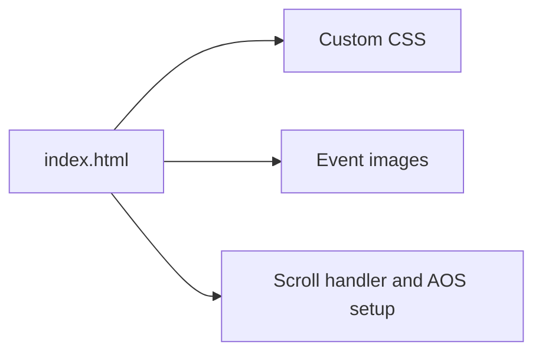

# ICISML 2024 Conference Website

A static event website for the **International Conference on Intelligent Systems and Machine Learning**, with information about the event, research tracks, committees, important dates, paper submission, and publication.

## Purpose

Conference information is easier to navigate when deadlines, tracks, and submission details share a clear page structure. This project implements that structure with HTML, CSS, images, and small JavaScript interactions.

## Included sections

- Event introduction and institute information.
- Research tracks and organizing committee content.
- Important dates, paper-submission information, and publication details.
- Contact information and supporting event imagery.
- Scroll-dependent navigation styling and AOS animation initialization.

## View locally

Download and extract the repository, then open [index.html](index.html) in a browser. There is no package manifest or application build step.

For a local HTTP preview, run from the repository root with Python 3 installed:

```bash
python3 -m http.server 8000
```

Open `http://localhost:8000`. External styles, scripts, or links referenced by the page require network access.

## Architecture



## Source guide

| Path | Responsibility |
| --- | --- |
| [index.html](index.html) | Event content and navigation |
| [assets/css/custom.css](assets/css/custom.css) | Browser stylesheet |
| [assets/css/custom.scss](assets/css/custom.scss) | SCSS source |
| [assets/js/script.js](assets/js/script.js) | Navigation scroll behavior and animations |
| [assets/images](assets/images) | Event and speaker assets |

## Content and reuse

The page contains historical ICISML 2024 content and dates. It is not a current announcement or a live registration/submission backend. Review dates, links, organizer details, and image permissions before adapting it for another event. Preserve the original event and institutional attribution when reusing associated content.
